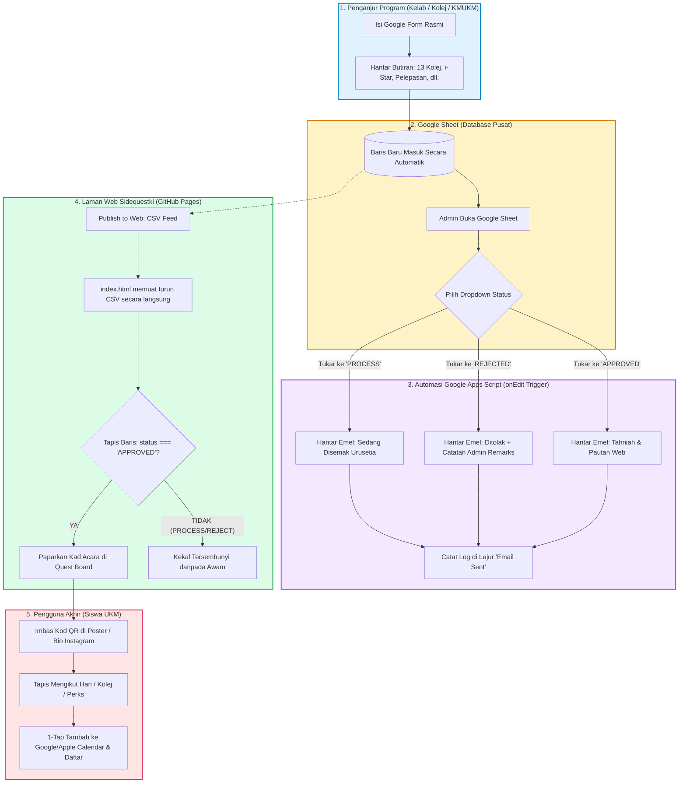

# 🗺️ Sidequestki & Project Mass Media UKM — End-to-End System Flow & Architecture

> **Ringkasan Sistem:**  
> Sidequestki ialah platform agregator aktiviti & penyerahan hebahan media kampus UKM yang beroperasi secara **100% automatik dan tanpa pelayan (*serverless*)**, menghubungkan **Google Forms $\rightarrow$ Google Sheets $\rightarrow$ Google Apps Script $\rightarrow$ Laman Web Live GitHub Pages**.

---

## 1. Gambar Rajah Aliran Keseluruhan (Mermaid Diagram)



---

## 2. Pecahan 5 Fasa Aliran Sistem (Step-by-Step Breakdown)

### Fasa 1: Pengambilan Maklumat Berpusat (Google Forms)
* **Punca:** Pengarah program atau Exco Publisiti dari kelab/kolej kediaman membuka Google Form rasmi.
* **Maklumat Ditapis:** 
  * Asas: Nama program, tarikh, masa, lokasi dewan/bilik spesifik.
  * Skop Kolej: Tertutup vs Terbuka (Pilihan **13 Kolej Kediaman UKM + Pelajar Luar Kampus/NR**).
  * Manfaat Siswa: Peringkat & Teras **Merit i-Star**, **Surat Pelepasan Kuliah HEP/Dekan**, makanan, bas, dan pelepasan *curfew* 11:00 malam.
  * Urusetia vs Peserta: Senarai biro yang dibuka atau pautan pendaftaran peserta.
* **Hasil:** Sebaik sahaja butang *Submit* ditekan, data masuk terus ke baris Google Sheet dalam masa 1 saat.

---

### Fasa 2: Pangkalan Data & Antara Muka Kurasi (Google Sheets)
* **Peranan:** Google Sheet berfungsi sebagai pangkalan data utama (*database*) dan *Content Management System (CMS)* tanpa bayaran bulanan.
* **Struktur Kawalan Admin:**
  1. **Lajur `Status` (Dropdown):**
     * 🟡 `PROCESS` (Kuning) — Menandakan borang telah diterima dan sedang disemak.
     * 🟢 `APPROVED` (Hijau) — Program disahkan sah, poster siap, dan layak dihebahkan.
     * 🔴 `REJECTED` (Merah) — Maklumat tidak lengkap atau pautan rosak.
  2. **Lajur `Admin Remarks`:** Tempat admin menaip sebab penolakan atau nota tambahan.
  3. **Lajur `Email Sent`:** Mengelakkan emel berulang dihantar sekiranya baris yang sama diedit semula.

---

### Fasa 3: Automasi Pintar & Pengembalian Status (Google Apps Script)
* **Mekanisme:** Menggunakan *Installable Trigger* `onEdit` yang sentiasa memantau perubahan pada lajur status.
* **Tindakan Automatik:**
  * **Apabila ditukar ke `PROCESS`:** Sistem menghantar emel bertajuk *"[Sidequestki UKM] Status: Permohonan Program Sedang Diproses"*. Pemohon berasa yakin bahawa permohonan mereka tidak diabaikan.
  * **Apabila ditukar ke `APPROVED`:** Sistem menghantar emel tahniah bersama pautan laman web *Live Quest Board*.
  * **Apabila ditukar ke `REJECTED`:** Sistem menghantar emel memohon pembetulan bersama ulasan dari lajur *Admin Remarks*.
  * Sebaik sahaja emel berjaya keluar melalui kuota Google Workspace/Gmail, lajur `Email Sent` ditandakan dengan `SENT - [STATUS]`.

---

### Fasa 4: Suapan Data & Penapisan Laman Web (`index.html`)
* **Penyambung Data:** Google Sheet diterbitkan ke web dalam format **CSV Awam** (*Publish to Web $\rightarrow$ CSV*).
* **Pemprosesan di Laman Web (`index.html`):**
  1. Pelayar pengguna memanggil pautan suapan CSV menggunakan JavaScript `fetch()`.
  2. Fungsi pengurai CSV (*RFC 4180 Parser*) menukar teks CSV menjadi objek JSON.
  3. **Logik Penapisan Keselamatan:**
     ```javascript
     allEvents = parsed.filter(row => row.status.trim().toUpperCase() === 'APPROVED');
     ```
     Hanya acara yang berstatus **APPROVED** sahaja yang akan dibina menjadi kad (*cards*). Acara yang masih `PROCESS` atau `REJECTED` tidak akan sesekali terdedah kepada umum.

---

### Fasa 5: Pengalaman Pelajar UKM (Front-End & Utiliti)
* **Navigasi Cepat:**
  * **Tapis Mengikut Hari:** Isnin hingga Ahad atau "All Days".
  * **Tapis Mengikut Faedah (Loot Pills):** 🍔 *Free Makan*, 🎖️ *Merits (i-Star)*, 📜 *E-Cert*, 🎟️ *Free Entry*.
  * **Carian Teks Penuh:** Boleh cari nama kolej (cth: "KIY", "KDO", "Pusanika", "Coding").
* **Penyelarasan Kalendar (1-Tap Sync):**
  * **Google Calendar:** Menjana pautan terus ke kalendar Google pengguna lengkap dengan peringatan 1 jam sebelum acara.
  * **Apple / Outlook Calendar:** Menjana fail `.ics` yang boleh dimuat turun terus ke dalam telefon pintar iPhone/Android.

---

## 3. Matriks Komponen & Lokasi Fail Projek

| Komponen | Fail / Pautan Terlibat | Tanggungjawab |
| :--- | :--- | :--- |
| **Borang Hebahan** | [`generate_google_form.js`](generate_google_form.js) | Skrip pembina Google Form 39 soalan lengkap kriteria UKM. |
| **Enjin Emel & Status** | [`google_apps_script_automation.js`](google_apps_script_automation.js) | Logik semakan status, dropdown automatik, dan penghantaran emel HTML. |
| **Laman Web Utama** | [`index.html`](index.html) | Paparan papan kenyataan aktiviti (*Quest Board*) berasaskan tema Disney Cruise Line Luxury. |
| **Panel Admin Tempatan** | [`admin.html`](admin.html) | Antara muka semakan pantas bagi pentadbir projek. |
| **Bahan Promosi & QR** | [`generate_poster_pdf.py`](generate_poster_pdf.py), [`generate_qr.py`](generate_qr.py) | Penjanaan kod QR fizikal dan poster edaran di sekitar kolej UKM. |

---

## 4. Kelebihan Utama Seni Bina Ini

1. **Kos Operasi RM0 (Zero Infrastructure Cost):** Memanfaatkan sepenuhnya kuota percuma Google Workspace UKM dan GitHub Pages tanpa kos pelayan.
2. **Kalis Beban (*High Scalability*):** Tapak web statik boleh menampung ribuan akses serentak semasa minggu orientasi atau pesta kolej tanpa risiko ranap (*server crash*).
3. **Penyelarasan Masa Nyata (*Real-Time Sync*):** Admin hanya perlu menguruskan satu fail Google Sheet di telefon atau laptop — laman web akan dikemas kini serta-merta tanpa perlu sentuh sebarang kod pengaturcaraan.
